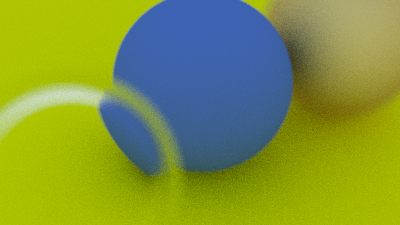
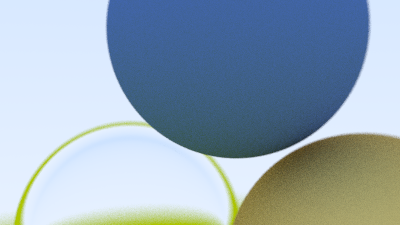
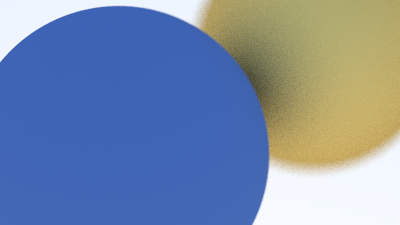
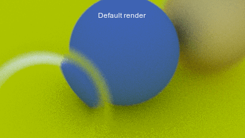
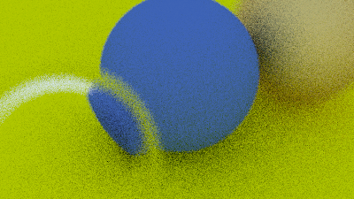
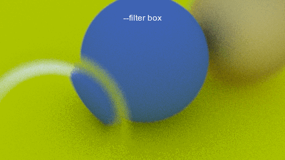
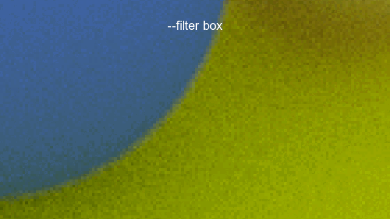

# Weekday Ray Tracer

A compact path tracer written from scratch in C++17. It renders scenes of spheres and boxes with diffuse, metallic, and dielectric materials, depth of field, selectable sampling filters, and an optional Sobel edge pass.

The project began by following [*Ray Tracing in One Weekend*](https://raytracing.github.io/books/RayTracingInOneWeekend.html), which provided the foundation for the ray, camera, geometry, and material code. It now extends that foundation with runtime scene controls, framebuffers, multiple sampling methods, and image post-processing.

## Build Requirements

- A C++17 compiler
- `make` (optional)
- An image viewer that supports PPM files

## Quick start

Build the renderer:

```bash
make
```

Render a fast preview of the default scene:

```bash
./main --preview > preview.ppm
```

Open `preview.ppm` in an image viewer that supports PPM. The renderer writes an ASCII PPM (`P3`) image to standard output, while progress and timing are written to the terminal.

For a higher-quality render:

```bash
./main > image.ppm
```

Preview mode is intended for fast iteration; the full render trades additional time for a cleaner image.

As a representative measurement, rendering the `original` scene at 400 px wide with the box filter took 1.84 s in preview mode and 18.97 s at full quality on the development machine—about 10× faster, or roughly 90% less render time. Actual times depend on hardware, compiler, scene, resolution, and settings.

## Command-line options

### Scenes

Select a scene at runtime:

```bash
./main --scene original > original.ppm
./main --scene custom > custom.ppm
./main --scene new-camera > new-camera.ppm
```

| `original` | `custom` | `new-camera` |
| --- | --- | --- |
|  |  |  |
| A classic arrangement of diffuse, glass, and metal spheres. | A larger composition for camera and depth-of-field experiments. | A minimal two-sphere scene for isolating camera changes. |

### Quality and sampling

```text
--preview                 Use 10 samples and 10 ray bounces
--width N                 Set image width; accepted range is 128–2048
--samples N               Set samples per pixel; accepted range is 10–200
--depth N                 Set maximum ray depth; accepted range is 10–100
--filter box|tent         Choose the sampling filter
```

Example:

```bash
./main --scene custom --width 800 --samples 150 --depth 50 --filter tent > custom.ppm
```

### Edge post-processing

<table>
<tr>
<td valign="top"><code>--edges</code> detects boundaries using the depth and surface-normal buffers, blurs the resulting mask, and composites it with the rendered colour.</td>
<td></td>
</tr>
</table>

## Sampling comparisons

These comparisons use the same scene and resolution while changing the indicated quality or sampling setting.

<table>
<tr>
<td></td>
<td></td>
</tr>
<tr>
<td><code>--preview</code>: 10 samples per pixel, 10 ray bounces</td>
<td>Full quality (default): 100 samples per pixel, 50 ray bounces</td>
</tr>
</table>

For the <code>--filter</code> comparison, both animations alternate between the <code>box</code>- and <code>tent</code>-filtered versions of the same PPM renders. The crops show different regions of the scene; only the sampling filter changes between frames.

<table>
<tr>
<td></td>
<td></td>
</tr>
<tr>
<td>Original scene with default flags</td>
<td>A zoomed view of the high-contrast sphere boundary</td>
</tr>
</table>

The box filter gives every sample equal weight. The tent filter gives samples closer to the pixel centre more weight, which can soften some pixel-level variation.


## How the renderer works

Rendering is split into three stages:

1. **Geometry pass** casts one camera ray per pixel and stores the first hit's depth and surface normal
2. **Colour pass** casts jittered rays per pixel, recursively evaluates material scattering, and stores the accumulated colour
3. **Post-processing pass** currently only optionally detects and blurs edges, composites the edge mask with the colour buffer, and writes the final image

The framebuffer pipeline separates ray tracing from image processing and makes neighbouring-pixel effects such as edge detection possible.


## Project structure

```text
├── main.cpp          Scene definitions, materials, command-line parsing, entry point
├── camera.h          Camera setup, render passes, framebuffers, sampling, post-processing
├── material.h        Lambertian, metal, and dielectric materials
├── sphere.h          Sphere primitive and intersection logic
├── box.h             Axis-aligned box primitive
├── hittable.h        Hittable interface and hit records
├── hittable_list.h   Collection of scene objects
├── ray.h             Ray representation
├── vec3.h            Vector, point, and random utility functions
├── color.h           Colour output and gamma correction
├── interval.h        Interval utility for hit-range checks
├── rtweekday.h       Shared constants and standard-library setup
└── Makefile          C++17 build targets
```

Clean the local build with:

```bash
make clean
```
